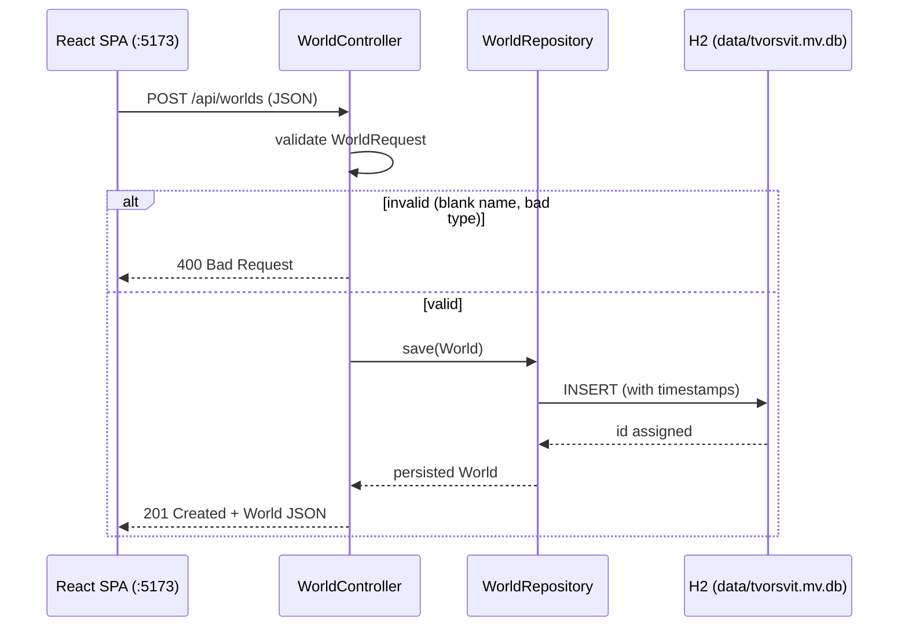

# REST API

Base URL: `http://localhost:8081` · Content type: `application/json` · CORS: `http://localhost:5173` allowed for all `/api/**` routes.

## Endpoints

| Method | Path | Purpose | Success |
|---|---|---|---|
| GET | `/api/status` | Service health / availability | 200 |
| GET | `/api/worlds` | List all worlds, newest first | 200 |
| POST | `/api/worlds` | Create a world | 201 (created body) |
| GET | `/api/worlds/{id}` | Fetch one world | 200 |
| PUT | `/api/worlds/{id}` | Update name / type / description / color | 200 (updated body) |
| PUT | `/api/worlds/{id}/content` | Update only the editor text | 200 (updated body) |
| DELETE | `/api/worlds/{id}` | Delete a world | 204 |
| GET | `/api/worlds/{id}/characters` | List characters of a world, creation order | 200 |
| POST | `/api/worlds/{id}/characters` | Create a character in a world | 201 (created body) |
| PUT | `/api/worlds/{id}/characters/{characterId}` | Update a character | 200 (updated body) |
| DELETE | `/api/worlds/{id}/characters/{characterId}` | Delete a character | 204 |
| GET | `/api/worlds/{id}/places` | List places of a world, creation order | 200 |
| POST | `/api/worlds/{id}/places` | Create a place in a world | 201 (created body) |
| PUT | `/api/worlds/{id}/places/{placeId}` | Update a place | 200 (updated body) |
| DELETE | `/api/worlds/{id}/places/{placeId}` | Delete a place | 204 |
| GET | `/api/worlds/{id}/place-relations` | List place↔place relations, optionally `?placeId=` | 200 |
| POST | `/api/worlds/{id}/place-relations` | Create a place↔place relation | 201 (created body) |
| PUT | `/api/worlds/{id}/place-relations/{relationId}` | Update a place relation | 200 (updated body) |
| DELETE | `/api/worlds/{id}/place-relations/{relationId}` | Delete a place relation | 204 |
| GET | `/api/worlds/{id}/character-relations` | List character↔character relations, optionally `?characterId=` | 200 |
| POST | `/api/worlds/{id}/character-relations` | Create a character↔character relation | 201 (created body) |
| PUT | `/api/worlds/{id}/character-relations/{relationId}` | Update a character relation | 200 (updated body) |
| DELETE | `/api/worlds/{id}/character-relations/{relationId}` | Delete a character relation | 204 |

Errors: unknown id → `404`; validation or malformed payload → `400`.

## World object

```json
{
  "id": 1,
  "name": "Middle-earth",
  "type": "BOOK",
  "description": "A long ago age",
  "color": "#646cff",
  "content": null,
  "createdAt": "2026-09-24T10:05:12.345",
  "updatedAt": "2026-09-24T10:05:12.345"
}
```

| Field | Type | Notes |
|---|---|---|
| id | number | assigned by the database |
| name | string | required, non-blank, trimmed, max 80 |
| type | string | required, one of `BOOK` `TABLETOP_RPG` `GAME_LORE` `SHORT_STORY` `SCREENPLAY` `COMIC` `OTHER` |
| description | string | optional, max 300 |
| color | string | optional hex accent, e.g. `#646cff` |
| content | string | editor text; set via `PUT /api/worlds/{id}/content` |
| createdAt / updatedAt | ISO-8601 string | timestamps |

`type` values are documented in `docs/data-model.md`.

## Character object

Characters always belong to a world; their id is only meaningful inside its world.

```json
{
  "id": 1,
  "worldId": 3,
  "name": "Kaelen of the Ashwastes",
  "description": "A wandering cartographer",
  "color": "#22c55e",
  "photoUrl": "https://example.com/kaelen.png",
  "eyeColor": "green",
  "skinTone": "olive",
  "hairColor": "auburn",
  "mbti": "INFJ",
  "quirks": "Hums while drawing",
  "favoritePhrase": "Maps never lie",
  "bornInPlaceId": null,
  "livesInPlaceId": 4,
  "customFields": [
    { "label": "Magic type", "value": "Fire" },
    { "label": "Rank", "value": "Archmage" }
  ],
  "createdAt": "2026-10-01T18:26:42.947",
  "updatedAt": "2026-10-01T18:26:42.947"
}
```

| Field | Type | Notes |
|---|---|---|
| id | number | assigned by the database |
| worldId | number | the owning world; required (path variable on create) |
| name | string | required, non-blank, trimmed, max 80 |
| description | string | optional, max 300 |
| color | string | optional hex accent, e.g. `#646cff` |
| photoUrl | string | optional, max 500; full URL or site-relative path |
| eyeColor / hairColor / skinTone | string | optional, max 30 each |
| mbti | string | optional; one of the 16 MBTI types (`INFJ`, `ENTP`, …) or omitted |
| quirks | string | optional, max 300 |
| favoritePhrase | string | optional, max 200 |
| bornInPlaceId | number | optional; a place id **in the same world** (else `404`) |
| livesInPlaceId | number | optional; a place id **in the same world** (else `404`) |
| customFields | array | optional ordered list of `{ label, value }`; see `docs/custom-fields.md` |
| createdAt / updatedAt | ISO-8601 string | timestamps |

The nested `world`, `bornInPlace` and `livesInPlace` associations are intentionally not serialized — the JSON carries only the ids, keeping payloads flat and light.

## Place object

Places always belong to a world; their id is only meaningful inside its world.

```json
{
  "id": 1,
  "worldId": 3,
  "name": "The Gilded Tankard",
  "description": "A busy tavern in the lower city",
  "photoUrl": "https://example.com/tankard.png",
  "color": "#22c55e",
  "customFields": [
    { "label": "Region", "value": "Lower city" },
    { "label": "Owner", "value": "Mira Voss" }
  ],
  "createdAt": "2026-10-19T12:00:00.000",
  "updatedAt": "2026-10-19T12:00:00.000"
}
```

| Field | Type | Notes |
|---|---|---|
| id | number | assigned by the database |
| worldId | number | the owning world; required (path variable on create) |
| name | string | required, non-blank, trimmed, max 80 |
| description | string | optional, max 500 |
| photoUrl | string | optional, max 500; full URL or site-relative path (no upload handling yet) |
| color | string | optional hex accent, e.g. `#646cff` |
| customFields | array | optional ordered list of `{ label, value }`; see `docs/custom-fields.md` |
| createdAt / updatedAt | ISO-8601 string | timestamps |

| Field | Type | Notes |
|---|---|---|
| id | number | assigned by the database |
| worldId | number | the owning world; required (path variable on create) |
| name | string | required, non-blank, trimmed, max 80 |
| description | string | optional, max 500 |
| photoUrl | string | optional, max 500; full URL or site-relative path (no upload handling yet) |
| color | string | optional hex accent, e.g. `#646cff` |
| createdAt / updatedAt | ISO-8601 string | timestamps |

Like characters, the nested `world` association is not serialized — the JSON carries only `worldId`.

## Place relation object

A place relation links two places of the same world (see `docs/place-relations.md`).

```json
{
  "id": 1,
  "worldId": 3,
  "fromPlaceId": 4,
  "toPlaceId": 9,
  "type": "PART_OF",
  "customLabel": null,
  "description": "Bree lies in Eriador",
  "createdAt": "2026-10-19T12:00:00.000",
  "updatedAt": "2026-10-19T12:00:00.000"
}
```

| Field | Type | Notes |
|---|---|---|
| id | number | assigned by the database |
| worldId | number | the owning world |
| fromPlaceId | number | required; a place in the same world |
| toPlaceId | number | required; a place in the same world, different from `fromPlaceId` |
| type | string | one of `LOCATED_IN` `PART_OF` `CONNECTED_TO` `NEIGHBOR` `OTHER` `CUSTOM` |
| customLabel | string | required when `type = CUSTOM`, else null |
| description | string | optional note, max 200 |
| createdAt / updatedAt | ISO-8601 string | timestamps |

## Character relation object

A character relation links two characters of the same world (see `docs/character-relations.md`). It is stored as a single row and is not mirrored.

```json
{
  "id": 1,
  "worldId": 3,
  "fromCharacterId": 5,
  "toCharacterId": 8,
  "type": "MENTOR",
  "customLabel": null,
  "description": "Taught him the old songs",
  "createdAt": "2026-10-19T12:00:00.000",
  "updatedAt": "2026-10-19T12:00:00.000"
}
```

| Field | Type | Notes |
|---|---|---|
| id | number | assigned by the database |
| worldId | number | the owning world |
| fromCharacterId | number | required; a character in the same world |
| toCharacterId | number | required; a character in the same world, different from `fromCharacterId` |
| type | string | one of `FRIEND` `FAMILY` `ROMANTIC` `RIVAL` `MENTOR` `ALLY` `OTHER` `CUSTOM` |
| customLabel | string | required when `type = CUSTOM`, else null |
| description | string | optional note, max 200 |
| createdAt / updatedAt | ISO-8601 string | timestamps |

## Example: create a character

```http
POST /api/worlds/3/characters
Content-Type: application/json

{
  "name": "Kaelen of the Ashwastes",
  "description": "A wandering cartographer",
  "color": "#22c55e"
}
```

Response `201 Created` (the stored character, with `id`, `worldId`, and timestamps filled in). `PUT` and `DELETE` use the same path with a `/characters/{characterId}` suffix. A character id that does not belong to the world in the path returns `404`.

## Example: create a world

Request:

```http
POST /api/worlds
Content-Type: application/json

{
  "name": "The Echoing Vale",
  "type": "TABLETOP_RPG",
  "description": "A haunted valley campaign setting",
  "color": "#22c55e"
}
```

Response `201 Created` (body is the full stored world, with `id` and timestamps filled in).

Minimal valid request — only `name` and `type` are required:

```json
{ "name": "Skyrim", "type": "GAME_LORE" }
```

## Example: save content

The world's content (editor text) is updated separately from its metadata:

```http
PUT /api/worlds/1/content
Content-Type: application/json

{ "content": "Chapter one. The valley slept." }
```

Response `200 OK` (the updated world, with `content` filled in). The metadata `PUT /{id}` deliberately ignores `content`, so editing world info can never wipe the user's writing.

## Validation rules

| Rule | Result |
|---|---|
| `name` blank or missing | 400 |
| `type` missing | 400 |
| `type` not one of the enum values | 400 |
| malformed JSON / unknown enum string | 400 |
| character `name` blank or missing | 400 |
| character `mbti` not one of the 16 types | 400 |
| character `bornInPlaceId` / `livesInPlaceId` not in the same world | 404 |
| custom field `label` longer than 80 or `value` longer than 500 | 400 |
| place `name` blank or missing | 400 |
| place relation endpoints equal | 400 |
| place relation `type = CUSTOM` without `customLabel` | 400 |
| character relation endpoints equal | 400 |
| character relation `type = CUSTOM` without `customLabel` | 400 |
| relation endpoint id not in the same world | 404 |

Validation lives on the request DTOs (`WorldRequest`, `CharacterRequest`, `PlaceRequest`, `PlaceRelationRequest`, `CharacterRelationRequest`) at the API boundary, so invalid payloads never reach the repository.

## Create flow

