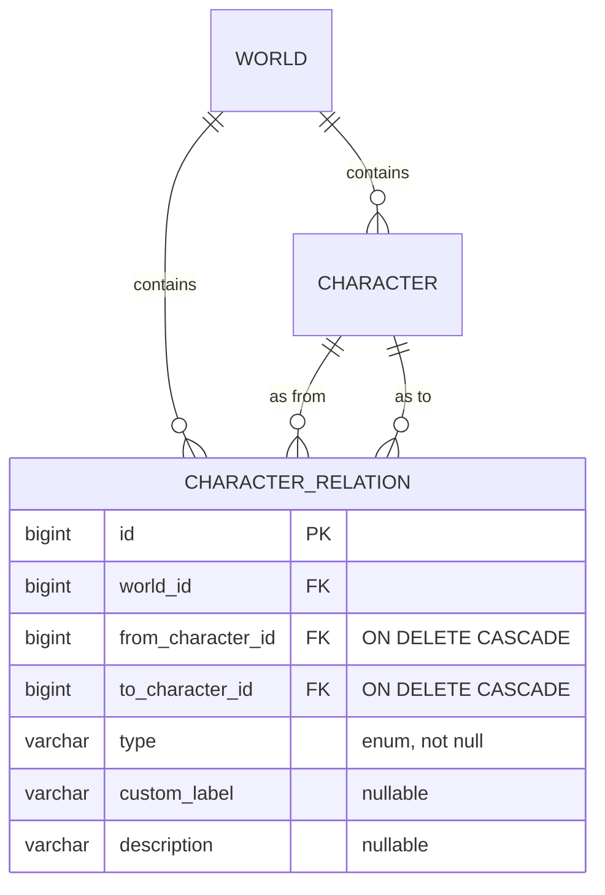
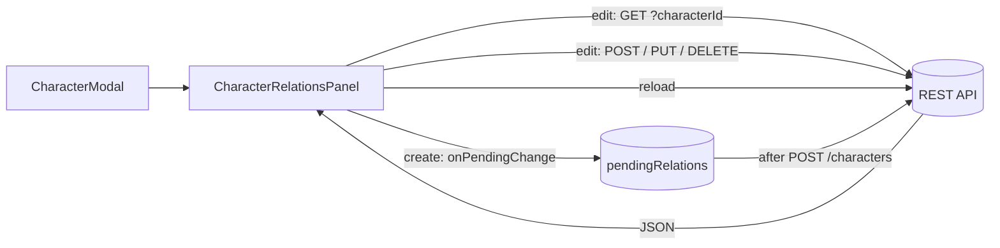

# Character Relations

Character relations connect two characters of the same world: friends, family, romantic links, rivals, allies, a mentor and their student. They are managed in the **Relations** section of `CharacterModal`, while creating or editing a character.

## Backend

New package members under `tvorsvit.character`:

```
tvorsvit/
  character/CharacterRelationType    -- enum
  character/CharacterRelation        -- the entity
  character/CharacterRelationRepository
  character/CharacterRelationRequest -- request DTO
  character/CharacterRelationController -- REST mapping under /api/worlds/{worldId}/character-relations
```

### Relation types

| Type | Meaning | Reading |
|---|---|---|
| FRIEND | friends | mutual |
| FAMILY | family | mutual |
| ROMANTIC | romantically involved | mutual |
| RIVAL | rivals | mutual |
| ALLY | allies | mutual |
| MENTOR | from is the mentor of to | directional |
| OTHER | anything else | directional |
| CUSTOM | anything else, with a free-text `customLabel` | directional |

Mutual types are stored as a **single row** and are understood in both directions by the UI. There is no mirrored row: a character can consider someone a friend while that person considers them a romantic interest — each direction can be its own row with its own type. Directional types (MENTOR, OTHER, CUSTOM) are only meaningful reading *from → to*.

### Endpoints

| Method | Path | Purpose | Success |
|---|---|---|---|
| GET | `/api/worlds/{worldId}/character-relations` | List all relations of a world | 200 |
| GET | `/api/worlds/{worldId}/character-relations?characterId=7` | List relations touching one character | 200 |
| POST | `/api/worlds/{worldId}/character-relations` | Create a relation | 201 (created body) |
| PUT | `/api/worlds/{worldId}/character-relations/{id}` | Update type / label / note / endpoints | 200 (updated body) |
| DELETE | `/api/worlds/{worldId}/character-relations/{id}` | Delete a relation | 204 |

Errors: unknown world → `404`; unknown relation id → `404`; either character id not in the world → `404`; `fromCharacterId == toCharacterId` → `400`; `type=CUSTOM` without a `customLabel` → `400`.

### Relation object

```json
{
  "id": 1,
  "worldId": 3,
  "fromCharacterId": 5,
  "toCharacterId": 8,
  "type": "MENTOR",
  "customLabel": null,
  "description": "Taught him the old songs",
  "createdAt": "2026-10-19T12:00:00.000",
  "updatedAt": "2026-10-19T12:00:00.000"
}
```

### Design decisions

- **A separate relation table, not reciprocal columns on `Character`.** A character can have any number of links, each with its own type and note, and links are asymmetric when the story calls for it.
- **World-scoped resource.** Relations live under `/api/worlds/{worldId}/character-relations`; both endpoints must be characters of that world — the controller verifies world ownership before writing, so cross-world links are impossible.
- **`ON DELETE CASCADE` on both character FKs.** Deleting a character removes the relations they take part in.
- **Direction lives in the row, and reads are symmetric.** `fromCharacterId` / `toCharacterId` carry the direction; `findByWorldAndCharacter` matches *either* endpoint, so both characters see the same row with the same direction — mutual types are never mirrored into a second row.
- **Flat JSON.** `world`, `fromCharacter` and `toCharacter` are `@JsonIgnore`d; derived getters expose `worldId`, `fromCharacterId`, `toCharacterId`.



## Frontend

- The **Relations section** is part of `CharacterModal` in **both modes** (`components/CharacterRelationsPanel.jsx`).
- **Editing** loads the relations touching the character via `GET /character-relations?characterId=…` (the query matches either endpoint, so a directional row appears on both characters). Each is shown as `From → Type → To` for directional types and `From ↔ Type ↔ To` for mutual ones, with character names resolved from the world's cast. Add / edit / delete call the API directly and reload.
- **Editing never flips direction.** The form remembers the original `fromCharacterId`, so editing a relation from the target's panel resends the same direction. `PUT` receives the original endpoints even when the note/type changes.
- **Creating** the character has no id yet, so the panel works on a **staged list** owned by `CharacterModal` (`pendingRelations`). Relations are queued locally (`This character → Type → Other`) and, once the create call returns the new id, the modal POSTs each one with `fromCharacterId` set to the new character. Any individual failure is reported without discarding the already-created character.
- The section is always rendered, even when there are no other characters yet: the header and an explanatory note stay visible instead of the panel disappearing. "Add relation" is only disabled when there is genuinely nothing to link to.
- **The read-only details view shows relations too.** `CharacterDetails` fetches the same `GET /character-relations?characterId=…` list and renders it under the character's fields, so opening "See {name} details" shows every relation the character is part of, not just the ones visible while editing.
- Direction rendering is centralized in `characterRelationTypes.js` (`describeCharacterRelation`), so the edit panel and the read-only details view can never disagree about which way an arrow points.
- Add / edit share one small form: related character (a select of the others), relation type, a custom label field that appears only for `CUSTOM`, and an optional note.

