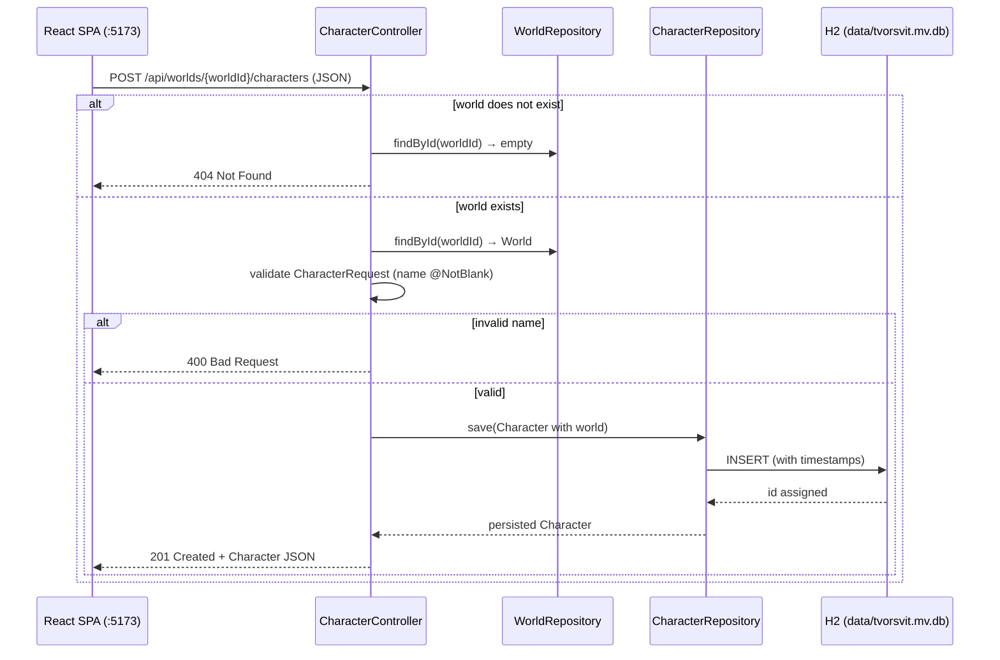
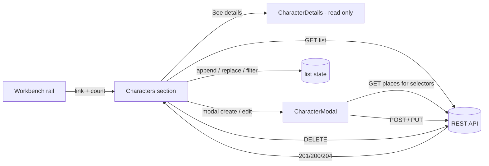

# Characters

Character cards are the first child entity of a world: named people (or beings) that belong to exactly one world. A world's cast is managed on its own page, `/worlds/:id/characters`, reached from the workbench rail.

A character starts as name + description + accent color, and can be filled out with optional detail: portrait, appearance (eye / hair color, skin tone), MBTI, quirks, a favorite phrase, and links to the places they were born in and live in.

## Backend

New package under `tvorsvit.character`, mirroring the `world` package structure:

```
tvorsvit/
  character/Character           -- the entity
  character/CharacterRepository -- Spring Data JPA repository
  character/CharacterRequest    -- request DTO (validation at the API boundary)
  character/CharacterController -- REST mapping, nested under /api/worlds/{worldId}/characters
```

### Endpoints

| Method | Path | Purpose | Success |
|---|---|---|---|
| GET | `/api/worlds/{worldId}/characters` | List characters of a world, in creation order | 200 |
| POST | `/api/worlds/{worldId}/characters` | Create a character in a world | 201 (created body) |
| PUT | `/api/worlds/{worldId}/characters/{id}` | Update name / description / color / detail fields | 200 (updated body) |
| DELETE | `/api/worlds/{worldId}/characters/{id}` | Delete a character | 204 |

Errors: unknown world → `404`; unknown id → `404`; character id that does not belong to the world in the path → `404`; blank name → `400`; invalid `mbti` → `400`; `bornInPlaceId` / `livesInPlaceId` pointing to a place in another world → `404`.

### Design decisions

- **World-scoped nesting.** The universe is hierarchical: a world has characters. Nesting the routes under `/api/worlds/{worldId}` mirrors that in the URL, and every mutation re-verifies the character belongs to the world in the path — a character from world A can never be edited through world B's URL.
- **No `@OneToMany` on `World`.** Worlds stay lean in JSON (no surprise child payloads, no lazy-loading traps). Characters are always loaded through explicit repository queries.
- **`@OnDelete(CASCADE)` on the world FK.** Deleting a world removes its characters at the database level, so a world delete can never fail on orphaned rows.
- **Optional place links.** `bornInPlace` / `livesInPlace` are optional `@ManyToOne` links to places in the same world. Their FKs use `ON DELETE SET NULL`, so deleting a place clears the character's link rather than deleting the character. The controller resolves the ids through `PlaceRepository.findByIdAndWorld_Id`, so a foreign world's place id is rejected with `404` before anything is written.
- **MBTI is a closed set.** The DTO's `@Pattern` accepts only the 16 valid types (or none), so typos never reach the database.
- **Custom fields.** Characters carry an ordered list of user-defined `{ label, value }` pairs (`character_custom_fields`) so the user can model anything the fixed fields do not cover — see `docs/custom-fields.md`.
- **Relations are shown in the read-only view too.** `CharacterDetails` loads the character's relations and lists them under the fixed/custom fields, so a full character sheet shows who they are connected to without opening the editor.
- **`worldId` / `bornInPlaceId` / `livesInPlaceId` in JSON instead of nested objects.** The associations are `@JsonIgnore`d and derived getters expose just the foreign keys — the API payload is flat and light.
- **Repository query** uses `findByWorld_Id` (explicit path with underscore) so Spring Data unambiguously traverses `world → id` rather than guessing a `worldId` property.

### Create flow



## Frontend

- Route `/worlds/:id/characters`, linked from the workbench rail with a live count (**Characters (n)**).
- `pages/Workspace.jsx` owns the list state. Mutations update the list in place — created characters are appended (matching the creation-order sort of the API), edited ones replace their slot, deleted ones are filtered out — no full refetch.
- `components/CharacterCard.jsx` shows name, description, and accent color, with **See {name} details** / Edit / Delete actions.
- `components/CharacterDetails.jsx` is the read-only view opened by the details action: it resolves the born-in / lives-in place ids to names (from the world's places) and lists every filled field, including the character's custom fields.
- `components/CharacterModal.jsx` is **one component, two modes**: `character === null` renders "New character" and calls `createCharacter`; a populated `character` renders "Edit character" and calls `updateCharacter`. The payload shape is identical, so only the API function and the title/button label differ. It loads the world's places on open to populate the **Born in** / **Lives in** selects and the 16 MBTI options, embeds the **Custom fields** editor (`CustomFieldsEditor.jsx`), and embeds the **Relations** section in both modes — in create mode relations are staged locally and saved after the character is created.

### UI data flow



## Relations and custom fields

Characters can be linked to each other: friend, family, romantic, rival, ally, mentor, or a custom label. Relations are managed in a **Relations** section inside the modal — available while creating and while editing — and are documented in `docs/character-relations.md`.

Beyond the fixed fields, the modal also offers **Custom fields**: arbitrary `label → value` pairs (for example "Magic type: Fire"). They are stored on the character and shown in the details view; see `docs/custom-fields.md`.