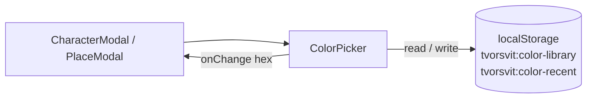

# Color Picker & Color Library

Every place that lets a user choose an accent color uses one shared, dependency-free picker (`components/ColorPicker.jsx`). On top of the browser's native color input, it offers a curated palette, the user's recently used colors, and a personal library of named colors that is shared across all worlds and persists between sessions.

## UI anatomy

```
┌───────────────────────────────────────────────┐
│ [native]  #a78bfa        [ Save to library… ] │
├───────────────────────────────────────────────┤
│ CURATED   ● ● ● ● ● ● ● ● ● ● ● ● ● ● ● ●     │
│ RECENT    ● ● ●                               │
│ MY LIBRARY  (● Ashwaste rust ×) (● Ocean ×)   │
└───────────────────────────────────────────────┘
```

- **Native input** — a plain `<input type="color">`, styled to match the app; the only piece that relies on the OS picker.
- **Curated** — a fixed palette (`CURATED_COLORS` in `colorLibrary.js`) seeded from the world-theme accents.
- **Recent** — the last colors the user picked, newest first, de-duplicated, capped at 12.
- **My library** — named colors the user saved, reusable in any world.

## Storage

Everything is client-side; no backend involvement.

| `localStorage` key | Shape | Notes |
|---|---|---|
| `tvorsvit:color-library` | `[{ name, color }]` | Named colors, newest first. Duplicate colors replace the existing entry. |
| `tvorsvit:color-recent` | `["#a78bfa", …]` | Up to 12 most recent colors, newest first. |

`src/colorLibrary.js` wraps storage access: reads are defensive (a corrupt or missing value falls back to an empty list) and writes swallow `localStorage` errors (private browsing, quota), so the picker never crashes the modal.

- **Save named** — "Save to library…" reveals a name field; the current color is stored under that name (an empty name falls back to the hex).
- **Reuse** — clicking a library chip, a curated swatch, or a recent swatch sets the value.
- **Delete** — the `×` on a library chip removes that entry.
- **Recently used** — every selection (swatches and the native input) is pushed to the top of the recent list.

## Usage

```jsx
import ColorPicker from './ColorPicker.jsx';

<ColorPicker value={form.color} onChange={(hex) => setField('color', hex)} />
```

The picker is fully controlled: it holds no color state of its own beyond the library and recent lists. It is used by `CharacterModal` and `PlaceModal`; worlds keep their fixed theme palettes (`worldThemes.js`), which supply the curated swatches.


