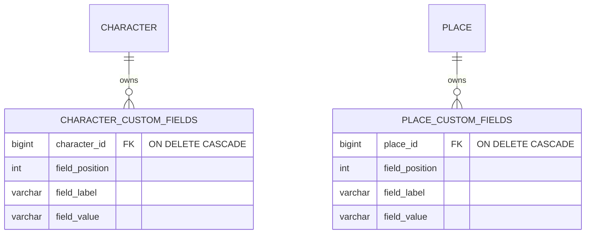
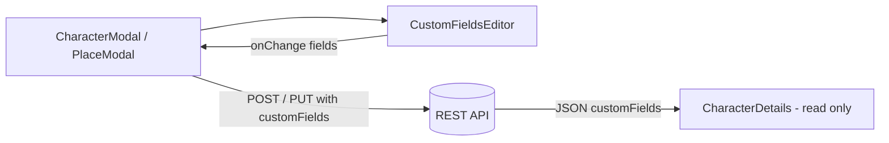

# Custom Fields

Custom fields let the user attach arbitrary labelled facts to a character or a place — "Magic type: Fire", "Rank: Archmage", "Region: Lower city" — without the app having to know those concepts ahead of time. They are ordered `label → value` pairs owned by exactly one character or place.

## Backend

```
tvorsvit/
  common/CustomField         -- @Embeddable { label, value }
  common/CustomFieldRequest  -- request DTO (length validation)
  common/CustomFields        -- shared apply(request, target) helper
```

`Character` and `Place` each embed an ordered, eagerly-fetched element collection:

```java
@ElementCollection(fetch = FetchType.EAGER)
@CollectionTable(name = "character_custom_fields", joinColumns = @JoinColumn(name = "character_id"))
@OrderColumn(name = "field_position")
@OnDelete(action = OnDeleteAction.CASCADE)
private List<CustomField> customFields = new ArrayList<>();
```

Place uses the same mapping with `place_custom_fields` / `place_id`.

### Rules

| Rule | Behaviour |
|---|---|
| Order | Preserved by `@OrderColumn` (the position is stored per row) |
| `label` | Trimmed; **blank labels are dropped**; max 80 chars (else `400`) |
| `value` | Trimmed; blank becomes `null`; max 500 chars (else `400`) |
| Empty list / omitted field | Clears all custom fields on that entity |
| Deletion | Rows are removed with the owning character/place (`ON DELETE CASCADE`), so a world delete cascades cleanly |
| Cross-world | Not possible — custom fields travel inside the parent payload, which is world-scoped |

`CustomFields.apply(...)` clears the target list and re-adds the request entries, so create and update share exactly one code path. Blank labels are skipped defensively on the server even though the UI never submits them.



### JSON shape

Custom fields are a plain array on the parent object — no separate endpoint:

```json
{
  "id": 1,
  "name": "Kaelen",
  "customFields": [
    { "label": "Magic type", "value": "Fire" },
    { "label": "Weakness", "value": null }
  ]
}
```

## Frontend

- `components/CustomFieldsEditor.jsx` is the reusable editor: a list of `label` / `value` inputs with a **Remove** button per row and an **Add custom field** button. It is a controlled component (`fields` + `onChange`), so each modal owns the array in its form state.
- It is embedded in both `CharacterModal.jsx` and `PlaceModal.jsx`, and the array is sent as part of the normal create/update payload (blank labels are filtered client-side too).
- `CharacterDetails.jsx` renders every filled custom field as an extra `label → value` detail row. Places are edited through `PlaceModal`, where the same fields are shown.


