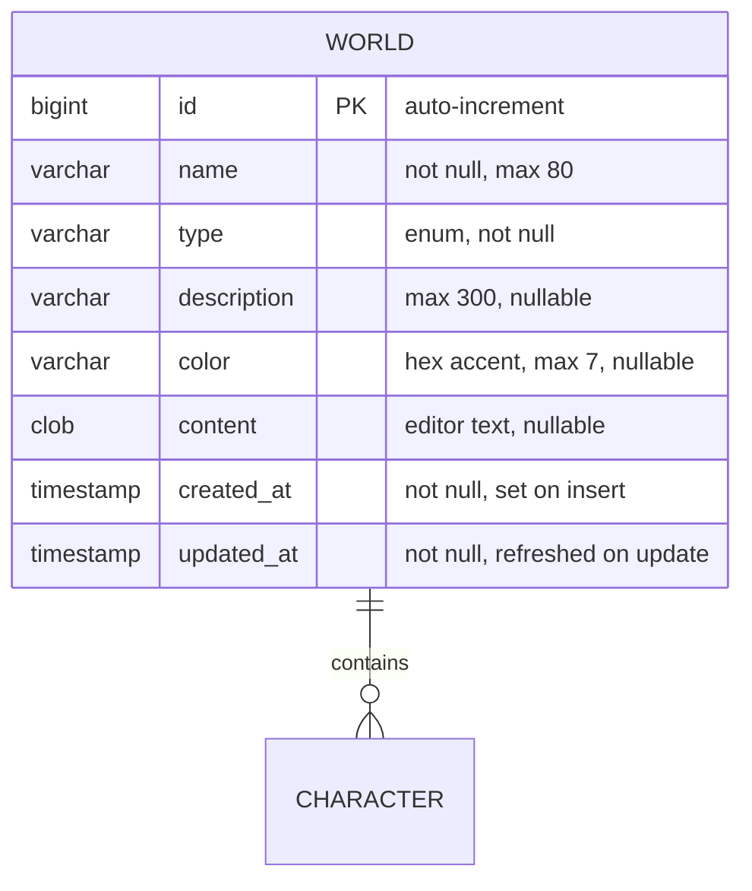
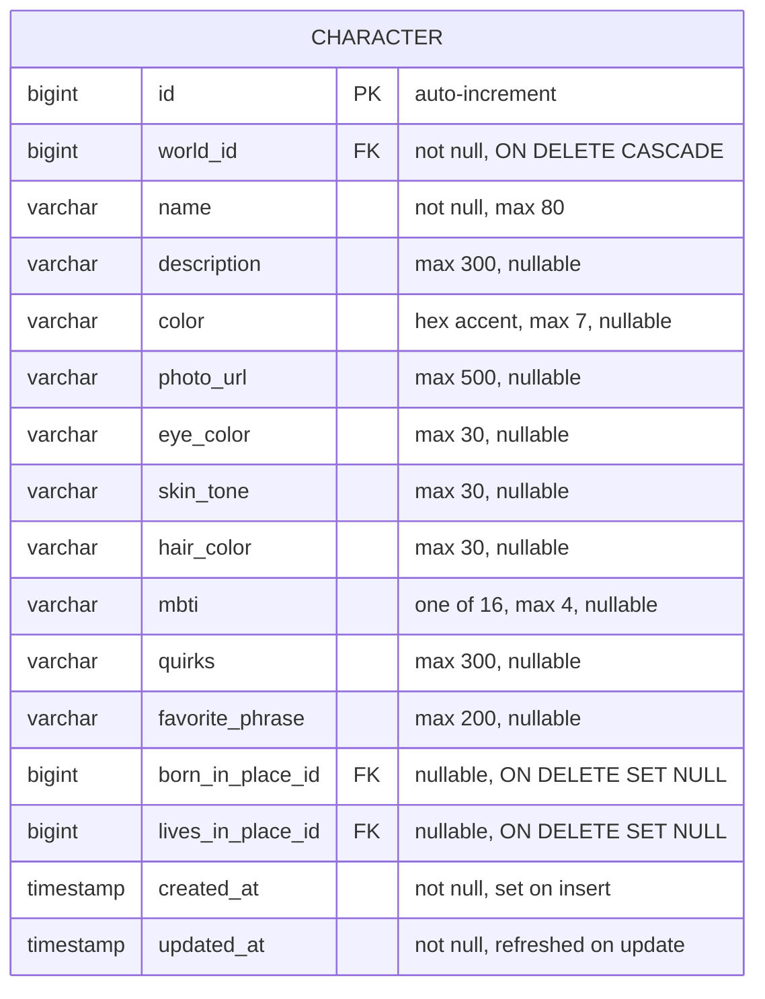
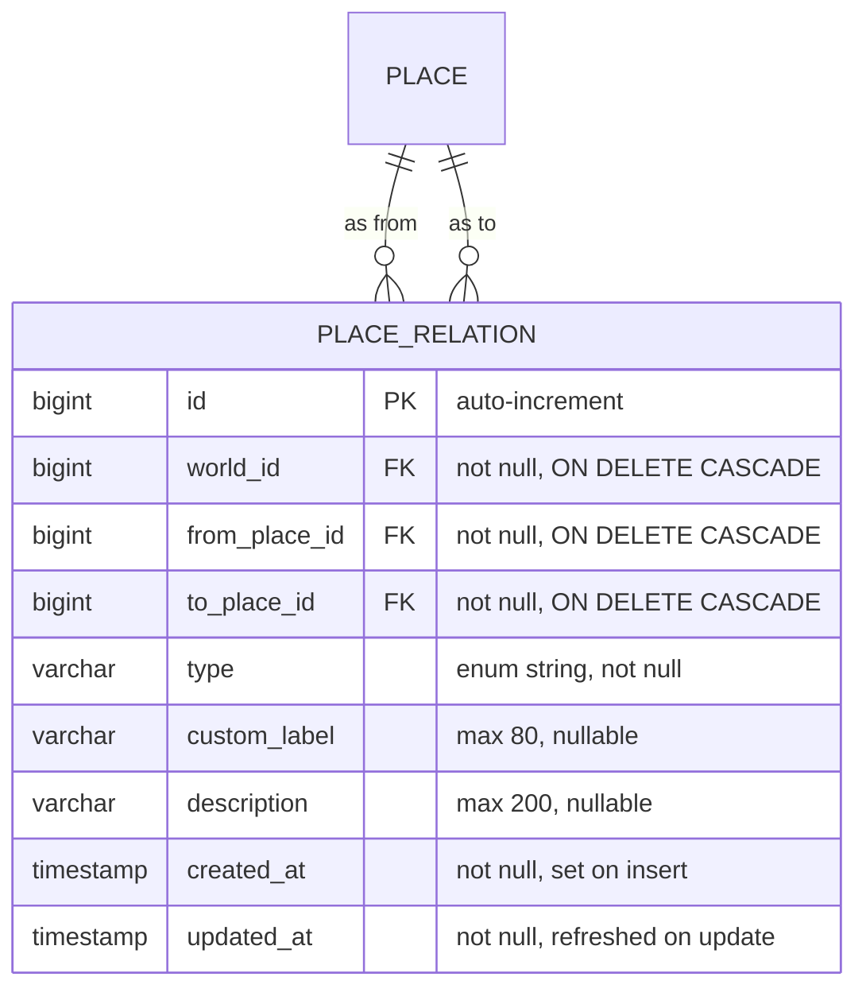
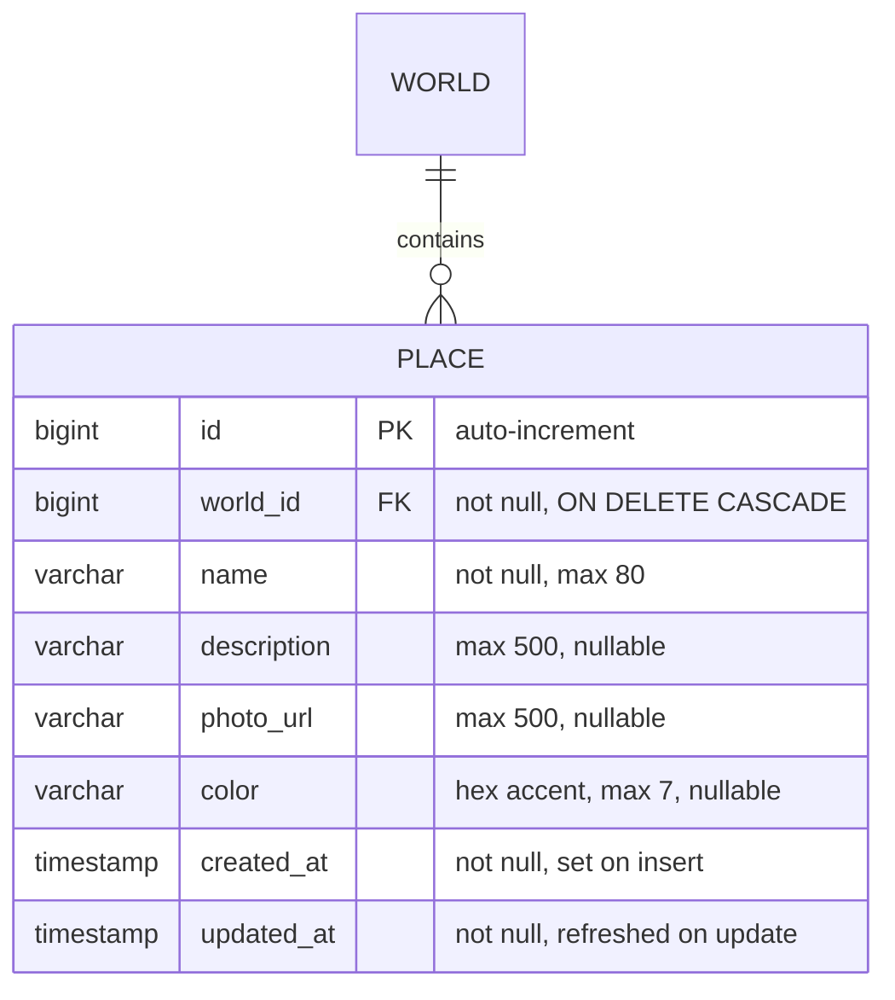
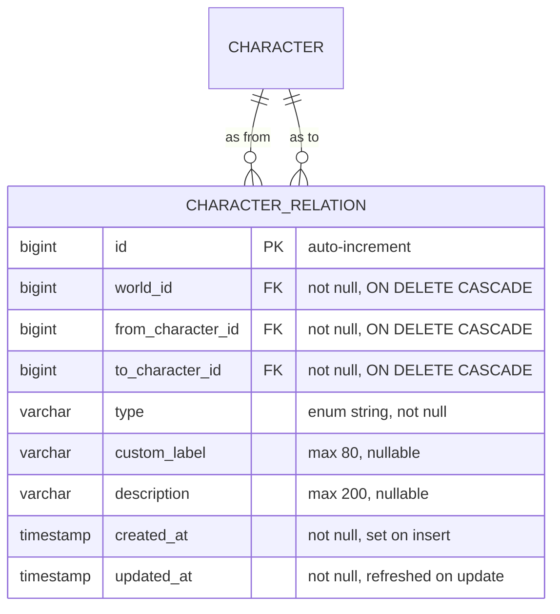
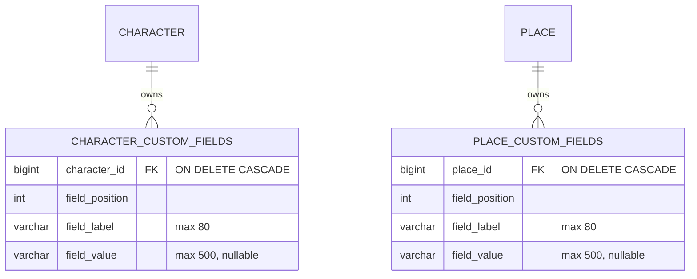

# Data model

How Tvorsvit stores data. Stack: Spring Boot 4.1, Spring Data JPA (Hibernate), H2 embedded file database.

## Storage overview

| Aspect | Detail |
|---|---|
| Database file | `data/tvorsvit.mv.db`, created on first run in the backend working directory |
| Schema management | Hibernate `ddl-auto=update` — tables are created/altered automatically on startup |
| Writes | Any process using the API (WAL-style file, `AUTO_SERVER=TRUE` allows multiple processes) |
| Git | `data/` is ignored — local worlds are never committed accidentally |
| Tests | A separate profile (`application-test.properties`) uses an in-memory H2 DB with `create-drop`, so automated tests never touch dev data |

## Entities

### World

A `World` is the top-level container: one story universe the user is building (a novel, a tabletop campaign, game lore, a screenplay, ...). All child entities (characters, locations, relationships) belong to a world.



Field notes:

- **type** — stored as a string enum (`EnumType.STRING`), not an ordinal. Reordering enum values in code therefore never corrupts existing rows, and the stored values stay readable (`BOOK`, `TABLETOP_RPG`, `GAME_LORE`, `SHORT_STORY`, `SCREENPLAY`, `COMIC`, `OTHER`).
- **created_at / updated_at** — inherited from `BaseEntity`, a `@MappedSuperclass`. JPA lifecycle callbacks (`@PrePersist` / `@PreUpdate`) stamp them, so every future entity gets audit timestamps for free, written once in one place.
- **content** — the drafting text, set via `PUT /api/worlds/{id}/content` (see `docs/api.md`).
- **color** — a hex accent used by the frontend cards and the editor theme.

### Character

A `Character` belongs to exactly one `World` (`@ManyToOne`, non-nullable foreign key `world_id`). Characters are world-scoped: they are created, listed, updated and deleted through nested routes under `/api/worlds/{worldId}/characters`.



Field notes:

- **world_id** — the owning world. The FK is declared `ON DELETE CASCADE` (`@OnDelete(CASCADE)`), so deleting a world removes its characters at the database level and can never fail on orphaned rows.
- **Rich optional fields** — `photo_url`, `eye_color`, `skin_tone`, `hair_color`, `mbti`, `quirks`, `favorite_phrase` are all optional and validated only for length (and `mbti` against the 16 valid types) on the request DTO. Existing rows/requests without them are unaffected.
- **born_in_place_id / lives_in_place_id** — optional `@ManyToOne` links to `Place` in the **same world**. The FKs are declared `ON DELETE SET NULL`, so deleting a place clears the link instead of deleting the character. A place id from another world is rejected with `404`.
- **JSON shape** — the `world`, `bornInPlace` and `livesInPlace` associations are `@JsonIgnore`d; derived getters expose `worldId`, `bornInPlaceId`, `livesInPlaceId`. The API payload stays flat, and the heavy `World` object (including its `content`) is never embedded in a character response.
- **Read path** — worlds do **not** hold a back-reference collection (`@OneToMany` is deliberately absent). Characters are loaded via `CharacterRepository.findByWorld_IdOrderByCreatedAtAsc`, so `World` objects stay lean and JSON cannot accidentally dump children.
- **Custom fields** — an ordered `@ElementCollection` of `{ label, value }` pairs (`character_custom_fields`, see `docs/custom-fields.md`). Eagerly fetched so the collection is initialized before the response is serialized, and cascaded on delete.

### PlaceRelation

A `PlaceRelation` links two `Place` rows in the same world (see `docs/place-relations.md`). It is a world-scoped join entity with a type and an optional note.



Field notes:

- **from_place_id / to_place_id** — both `ON DELETE CASCADE`, so deleting a place removes the relations it takes part in.
- **type** — stored as a string enum (`LOCATED_IN`, `PART_OF`, `CONNECTED_TO`, `NEIGHBOR`, `OTHER`, `CUSTOM`).
- **custom_label** — required by the controller when `type = CUSTOM`.
- **JSON shape** — `world`, `fromPlace`, `toPlace` are `@JsonIgnore`d; derived getters expose `worldId`, `fromPlaceId`, `toPlaceId`.

### Place

A `Place` belongs to exactly one `World` (`@ManyToOne`, non-nullable foreign key `world_id`), exactly like characters: names of locations in the world (towns, taverns, regions, …).



Field notes:

- **world_id** — same cascade rule as characters (`@OnDelete(CASCADE)`), so deleting a world removes its places too.
- **photo_url** — a plain URL/path string (no upload handling in this iteration).
- **JSON shape** — `world` is `@JsonIgnore`d; a derived getter exposes `worldId` only, keeping payloads flat.
- **Read path** — `PlaceRepository.findByWorld_IdOrderByCreatedAtAsc`, in creation order.
- **Custom fields** — the same ordered `@ElementCollection` used by characters, in `place_custom_fields` (see `docs/custom-fields.md`).

### CharacterRelation

A `CharacterRelation` links two `Character` rows in the same world (see `docs/character-relations.md`). Like `PlaceRelation` it is a world-scoped join entity with a type and an optional note; it is stored as one row and never mirrored.



Field notes:

- **from_character_id / to_character_id** — both `ON DELETE CASCADE`, so deleting a character removes the relations they take part in.
- **type** — stored as a string enum (`FRIEND`, `FAMILY`, `ROMANTIC`, `RIVAL`, `MENTOR`, `ALLY`, `OTHER`, `CUSTOM`). Mutual types are not mirrored; each direction can exist as its own row.
- **custom_label** — required by the controller when `type = CUSTOM`.
- **JSON shape** — `world`, `fromCharacter`, `toCharacter` are `@JsonIgnore`d; derived getters expose `worldId`, `fromCharacterId`, `toCharacterId`.

### CustomField (embeddable)

Characters and places each own an ordered list of user-defined `{ label, value }` pairs, so the app can model concepts it does not know in advance ("Magic type: Fire"). It is a JPA `@Embeddable`, not a standalone entity, and is stored in per-parent collection tables (see `docs/custom-fields.md`).



Field notes:

- **`@ElementCollection` + `@OrderColumn`** — rows are positional, preserving the order the user arranged them in.
- **Eager fetch** — the collection is initialized with the parent, because responses are serialized after the persistence context closes.
- **Cascade** — the collection-table FK to the parent is `ON DELETE CASCADE`, so deleting a character/place (or a whole world) removes its custom fields too.
- **JSON shape** — serialized inline as `customFields: [{ label, value }]`; there is no separate endpoint.

## Entity layout in code

```
tvorsvit/
  common/BaseEntity        -- createdAt / updatedAt (mapped superclass)
  common/CustomField       -- @Embeddable { label, value } (character + place custom fields)
  common/CustomFieldRequest -- request DTO (length validation)
  common/CustomFields      -- shared apply(request, target) helper
  world/World              -- the entity
  world/WorldType          -- enum
  world/WorldRepository    -- Spring Data JPA repository
  world/WorldRequest       -- request DTO (validation at the API boundary)
  world/WorldController    -- REST mapping
  character/Character      -- the entity (world-scoped)
  character/CharacterRepository
  character/CharacterRequest
  character/CharacterController
  character/CharacterRelationType  -- enum
  character/CharacterRelation      -- the entity (world-scoped link)
  character/CharacterRelationRepository
  character/CharacterRelationRequest
  character/CharacterRelationController
  place/Place              -- the entity (world-scoped)
  place/PlaceRepository
  place/PlaceRequest
  place/PlaceController
  place/PlaceRelationType  -- enum
  place/PlaceRelation      -- the entity (world-scoped link)
  place/PlaceRelationRepository
  place/PlaceRelationRequest
  place/PlaceRelationController
  config/WebConfig         -- global CORS
```

The request DTO (`WorldRequest`) is intentionally separate from the entity: validation (`@NotBlank`, `@NotNull`) lives on the DTO, while the entity only enforces database-level constraints (`nullable = false`, lengths). The API rejects bad input before it ever reaches the database.