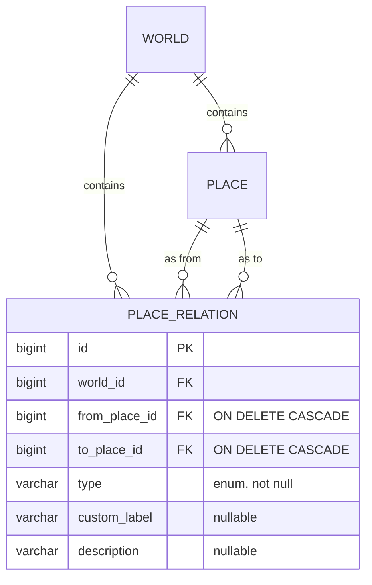
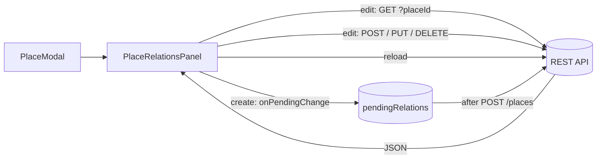

# Place Relations

Place relations link places inside a world: a town is part of a kingdom, a shop is located in a town, two taverns are neighbors, two roads are connected. Each relation belongs to one world and joins two places of that world.

## Backend

```
tvorsvit/
  place/PlaceRelationType        -- enum of relation kinds
  place/PlaceRelation            -- the entity (world-scoped edge)
  place/PlaceRelationRepository  -- Spring Data JPA repository
  place/PlaceRelationRequest     -- request DTO (validation at the API boundary)
  place/PlaceRelationController  -- REST mapping under /api/worlds/{worldId}/place-relations
```

### Types

| Type | Meaning | Direction |
|---|---|---|
| `LOCATED_IN` | from is located in to (a shop in a town) | directional |
| `PART_OF` | from is part of to (a town in a kingdom) | directional |
| `CONNECTED_TO` | the two places are linked (a road, a portal) | mutual |
| `NEIGHBOR` | the two places border each other | mutual |
| `OTHER` | anything else | directional |
| `CUSTOM` | anything else, with a free-text `customLabel` | directional |

Directional types read *from → to*. Mutual types are stored as a single row and are understood in both directions by the UI (no mirrored row is written).

### Endpoints

| Method | Path | Purpose | Success |
|---|---|---|---|
| GET | `/api/worlds/{worldId}/place-relations` | List all relations of a world | 200 |
| GET | `/api/worlds/{worldId}/place-relations?placeId=7` | List relations touching one place (incoming or outgoing) | 200 |
| POST | `/api/worlds/{worldId}/place-relations` | Create a relation | 201 (created body) |
| PUT | `/api/worlds/{worldId}/place-relations/{id}` | Update type / label / note / endpoints | 200 (updated body) |
| DELETE | `/api/worlds/{worldId}/place-relations/{id}` | Delete a relation | 204 |

Errors: unknown world → `404`; unknown relation id → `404`; either place id not in the world → `404`; `fromPlaceId == toPlaceId` → `400`; `type=CUSTOM` without a `customLabel` → `400`.

### Relation object

```json
{
  "id": 1,
  "worldId": 3,
  "fromPlaceId": 4,
  "toPlaceId": 9,
  "type": "PART_OF",
  "customLabel": null,
  "description": "Bree lies in Eriador",
  "createdAt": "2026-10-19T12:00:00.000",
  "updatedAt": "2026-10-19T12:00:00.000"
}
```

### Design decisions

- **Separate relation table, not columns on `Place`.** A place can have many relations, and relations carry their own type and note; a join table keeps `Place` lean and lets a place appear in any number of links.
- **World-scoped resource.** Relations live under `/api/worlds/{worldId}/place-relations` and both endpoints must be in that world — the controller resolves each id through `PlaceRepository.findByIdAndWorld_Id`, so cross-world links are impossible.
- **`ON DELETE CASCADE` on both place FKs.** Deleting a place removes the relations it takes part in, at the database level.
- **Direction lives in the row, and reads are symmetric.** `fromPlaceId` / `toPlaceId` carry the direction; the `?placeId=` query matches *either* endpoint, so both places see the same row with the same direction — mutual types are never mirrored.
- **Flat JSON.** `world`, `fromPlace` and `toPlace` are `@JsonIgnore`d; derived getters expose `worldId`, `fromPlaceId`, `toPlaceId`.



## Frontend

- The **Relations panel** lives inside `PlaceModal` in **both modes** (`components/PlaceRelationsPanel.jsx`).
- **Editing** loads the relations touching the place via `GET /place-relations?placeId=…` and lists them in the form `From → Type → To` (directional types) or `From ↔ Type ↔ To` (mutual types), using place names resolved from the world's places. Add / edit / delete call the API directly and reload.
- **Editing never flips direction.** The original `fromPlaceId` is remembered by the form and resent on save, so editing the relation from the target's panel cannot silently reverse it.
- **Creating** the place has no id yet, so the panel works on a **staged list** owned by `PlaceModal` (`pendingRelations`). Relations are queued locally and, once the create call returns the new id, the modal POSTs each one with `fromPlaceId` set to the new place. Any individual failure is reported without discarding the already-created place.
- The section is always rendered, even when there are no other places yet: the header and an explanatory note stay visible. "Add relation" is only disabled when there is genuinely nothing to link to.
- "Add relation" and inline editing reuse one small form: related place (a select of the other places), relation type, a custom label field that appears only for `CUSTOM`, and an optional note.

