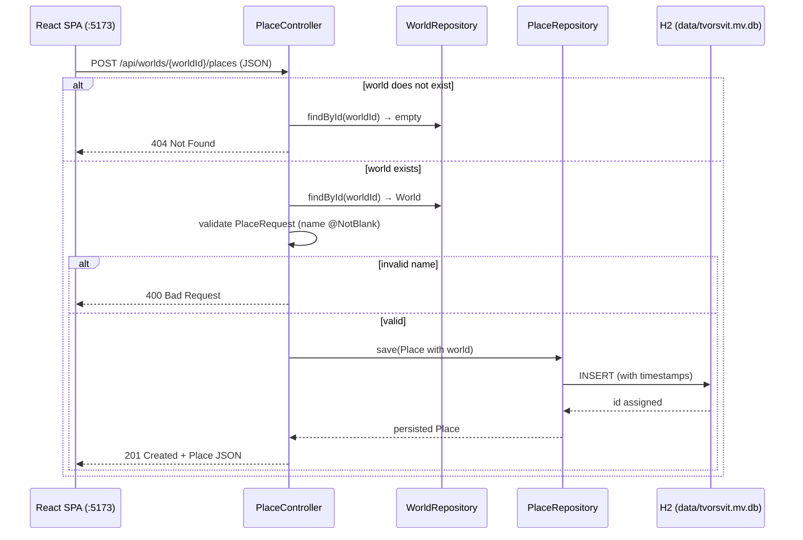
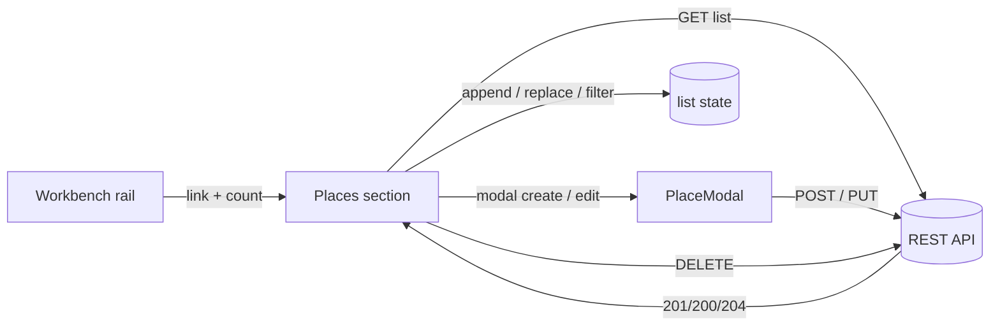

# Places

Places are the second child entity of a world: named locations that belong to exactly one world. A world's geography is managed on its own section, `/worlds/:id/places`, reached from the workbench rail.

## Backend

New package under `tvorsvit.place`, mirroring the `world` and `character` package structure:

```
tvorsvit/
  place/Place            -- the entity
  place/PlaceRepository  -- Spring Data JPA repository
  place/PlaceRequest     -- request DTO (validation at the API boundary)
  place/PlaceController  -- REST mapping, nested under /api/worlds/{worldId}/places
```

### Endpoints

| Method | Path | Purpose | Success |
|---|---|---|---|
| GET | `/api/worlds/{worldId}/places` | List places of a world, in creation order | 200 |
| POST | `/api/worlds/{worldId}/places` | Create a place in a world | 201 (created body) |
| PUT | `/api/worlds/{worldId}/places/{id}` | Update name / description / photoUrl / color | 200 (updated body) |
| DELETE | `/api/worlds/{worldId}/places/{id}` | Delete a place | 204 |

Errors: unknown world → `404`; unknown id → `404`; place id that does not belong to the world in the path → `404`; blank name → `400`.

### Design decisions

- **World-scoped nesting.** Same hierarchy as characters: a world has places. The route mirrors that in the URL, and every mutation re-verifies the place belongs to the world in the path — a place from world A can never be edited through world B's URL.
- **No `@OneToMany` on `World`.** Worlds stay lean in JSON. Places are loaded through explicit repository queries (`findByWorld_IdOrderByCreatedAtAsc`).
- **`@OnDelete(CASCADE)` on the FK.** Deleting a world removes its places at the database level, so a world delete can never fail on orphaned rows.
- **`worldId` in JSON instead of a nested `world`.** The association is `@JsonIgnore`d; a derived `getWorldId()` getter exposes only the foreign key, so character and place payloads stay flat and the heavy `World` object (including `content`) is never embedded.
- **Photo as a URL/path field.** `photoUrl` is a plain string (max 500) — no file upload handling in this iteration; the value can be an `https://…` URL or a site-relative path (`/images/…`).
- **Custom fields.** Places carry an ordered list of user-defined `{ label, value }` pairs (`place_custom_fields`), the same mechanism characters use — see `docs/custom-fields.md`.

### Create flow



## Frontend

- Section `/worlds/:id/places`, reachable from the workbench rail with a live count (**Places (n)**).
- `pages/Workspace.jsx` owns the list state (`places`). Mutations update the list in place — created places are appended (matching the creation-order sort of the API), edited ones replace their slot, deleted ones are filtered out — no full refetch.
- `components/PlaceCard.jsx` shows the photo (when `photoUrl` is set), name, description (clamped to 3 lines), and the accent color stripe, with Edit / Delete actions.
- `components/PlaceModal.jsx` is **one component, two modes**: `place === null` renders "New place" and calls `createPlace`; a populated `place` renders "Edit place" and calls `updatePlace`. It also validates the photo field (URL or site-relative path) and shows a live preview. It embeds the **Custom fields** editor (`CustomFieldsEditor.jsx`) and the **Relations** panel in both modes — in create mode relations are staged locally and saved after the place is created.

### Relations

Places can be linked to each other (located in, part of, connected, neighbors, custom). The Relations panel is part of `PlaceModal` in both modes and is documented in `docs/place-relations.md`.

### UI data flow

